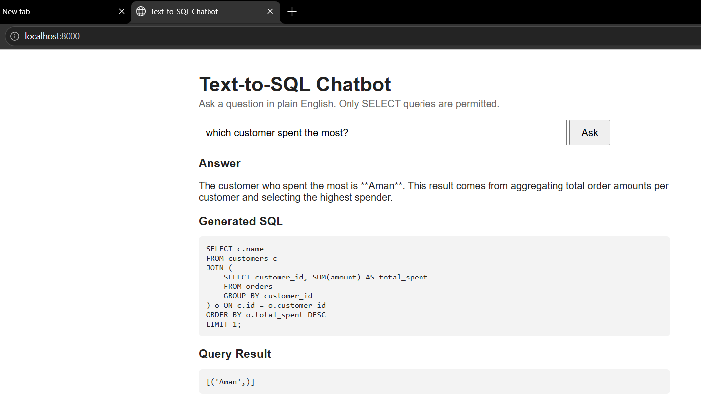

# Text-to-SQL Chatbot

Ask questions in plain English and get SQL queries and answers from a database.

## How it works
Question → LLM (Groq) → SQL → SQLite (read-only) → Answer

## Features
- Converts natural language questions into SQLite queries using an LLM
- Safety check: only `SELECT` queries are allowed (DROP, DELETE, UPDATE, INSERT and similar are blocked)
- Database opened in read-only mode as a second safety layer
- Shows the generated SQL, the raw result and a plain-English answer
- Lightweight: built with Python's standard library (`sqlite3`, `urllib`, `http.server`)
- Simple web interface that runs locally (`server.py`)

## Tech stack
Python, SQLite, Groq API (gpt-oss-120b), python-dotenv

## Project structure
```
text2sql-chatbot/
├── Create_database.py   # creates the sample shop.db database
├── engine.py            # question -> SQL -> result -> answer
├── server.py            # web interface (standard library only)
├── shop.db              # sample database
├── requirements.txt
├── output.png           # demo screenshot
└── README.md
```

## Setup
1. Clone the repository and open the project folder:
   ```bash
   git clone https://github.com/shailjapandey27/Projects.git
   cd Projects/text2sql-chatbot
   ```
2. Create and activate a virtual environment:
   ```bash
   python -m venv venv
   venv\Scripts\activate
   ```
3. Install dependencies:
   ```bash
   python -m pip install -r requirements.txt
   ```
4. Get a free API key from [console.groq.com](https://console.groq.com) and create a `.env` file:
   ```
   GROQ_API_KEY=your_key_here
   ```
5. (Optional) Recreate the sample database. A ready-made `shop.db` is already included:
   ```bash
   python Create_database.py
   ```

## Run
Terminal version:
```bash
python engine.py
```

Web interface, then open http://localhost:8000:
```bash
python server.py
```

## Example questions
- Which customer spent the most?
- How many customers are there?
- Total sales by city
- Orders above 10000
- Delete all orders → blocked by the safety check

## Sample database
Two tables: `customers` (id, name, city) and `orders` (id, customer_id, product, amount, order_date).

## Future improvements
- Support for MS SQL and other databases
- Self-correction when a generated query fails
- Charts for query results
- Chat history for follow-up questions

## Demo
